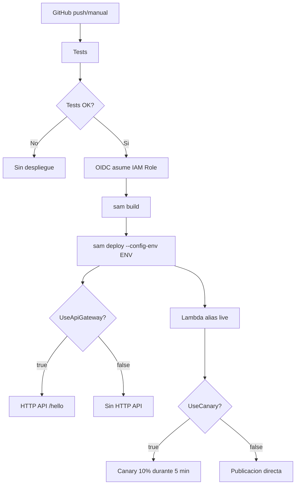

# Lambda multiproposito con AWS SAM

Proyecto de ejemplo para desplegar una funcion Lambda Python con AWS SAM. La plantilla
permite activar opcionalmente HTTP API, ALB y despliegues canary mediante parametros.
Los entornos configurados son `dev`, `staging` y `prod`.

> **Estado actual:** este repositorio es una base de trabajo. Antes de desplegar en AWS,
> ejecuta `sam validate` y revisa la plantilla y los permisos IAM en una cuenta no
> productiva. La configuracion de ALB requiere subredes y un security group.

## Requisitos

- Python 3.12.
- AWS SAM CLI 1.127 o posterior.
- AWS CLI v1 (`aws`, se instala con `make install`).
- GitHub CLI (`gh`), necesaria para configurar el secreto del repositorio.
- Una cuenta AWS y credenciales locales configuradas para las pruebas de SAM.
- GNU Make (opcional, pero recomendado).

Instala las dependencias del proyecto con:

```bash
make install
```

Comprueba todas las herramientas locales con:

```bash
make check-dependencies
```

`gh` debe instalarse como herramienta del sistema y autenticarse con `gh auth login`.
En Ubuntu/Debian puede instalarse siguiendo la [guia oficial de GitHub CLI](https://github.com/cli/cli/blob/trunk/docs/install_linux.md); en macOS, con
`brew install gh`. La instalacion de `aws` queda incluida en `requirements-dev.txt`.

## Primeras pruebas locales

Empieza por validar el codigo y la plantilla antes de intentar un despliegue:

```bash
make install
make test
sam validate --template-file template.yaml
```

`make test` ejecuta `pytest` y comprueba las respuestas `/hello` y `404` del handler.
`sam validate` comprueba la sintaxis y la transformacion SAM; no crea recursos ni
valida que la cuenta tenga todos los permisos necesarios.

La integracion con ALB y HTTP API se declara mediante recursos CloudFormation
condicionados en `template.yaml`, porque SAM no admite `ALB` como tipo de evento.
Si la validacion falla, corrige el error antes de desplegar y no lo silencies en CI.

Para construir el artefacto local:

```bash
make build
```

Para invocar la funcion con SAM, una vez validada la plantilla:

```bash
sam local invoke Function -e events/hello.json
```

El repositorio no incluye todavia `events/hello.json`; puedes crear un evento con esta
estructura cuando quieras probar la invocacion local:

```json
{
	"rawPath": "/hello",
	"requestContext": {"http": {"method": "GET"}}
}
```

## Flujo de CI/CD

Cada push a `main` y cada ejecucion manual inicia primero los tests. El despliegue solo
continua si los tests terminan correctamente. En ejecuciones manuales se selecciona el
entorno; si no se especifica, se usa `dev`.



## Configurar GitHub y AWS

El workflow está en `.github/workflows/deploy.yml` y usa autenticacion OIDC; no se
guardan claves AWS de larga duracion en GitHub.

### 1. Crear el rol de despliegue en AWS

Crea un IAM role dedicado, por ejemplo `github-actions-lambda-deploy`, con una trust
policy que permita a GitHub emitir tokens OIDC solo para este repositorio, la rama
`main` y los entornos usados por el workflow. Sustituye `AWS_ACCOUNT_ID` y
`OWNER/REPOSITORY`:

```json
{
	"Version": "2012-10-17",
	"Statement": [{
		"Effect": "Allow",
		"Principal": {"Federated": "arn:aws:iam::AWS_ACCOUNT_ID:oidc-provider/token.actions.githubusercontent.com"},
		"Action": "sts:AssumeRoleWithWebIdentity",
		"Condition": {
			"StringEquals": {"token.actions.githubusercontent.com:aud": "sts.amazonaws.com"},
			"StringLike": {"token.actions.githubusercontent.com:sub": [
				"repo:OWNER/REPOSITORY:ref:refs/heads/main",
				"repo:OWNER/REPOSITORY:environment:dev",
				"repo:OWNER/REPOSITORY:environment:staging",
				"repo:OWNER/REPOSITORY:environment:prod"
			]}
		}
	}]
}
```

El proveedor OIDC `token.actions.githubusercontent.com` debe existir en la cuenta.
Asigna al role una politica con los permisos minimos necesarios para `sam build` y
`sam deploy` (CloudFormation, Lambda, S3 y los recursos que active la plantilla).
Para una primera prueba puede usarse una politica amplia en una cuenta aislada, pero
debe reemplazarse por una politica restringida antes de produccion.

### 2. Crear el secreto del repositorio

En GitHub abre **Settings > Secrets and variables > Actions > New repository secret** y
crea:

- `AWS_DEPLOY_ROLE_ARN`: ARN completo del role, por ejemplo
	`arn:aws:iam::123456789012:role/github-actions-lambda-deploy`.

### 3. Configurar los entornos de GitHub

Crea los entornos `dev`, `staging` y `prod` en **Settings > Environments**. Para
`staging` y `prod` se recomienda exigir aprobacion y restringir las ramas permitidas.
El workflow selecciona el entorno con `inputs.environment`; los pushes a `main` usan
`dev` automaticamente.

### 4. Ejecutar el workflow

Haz push a `main` o ve a **Actions > Deploy SAM > Run workflow**, selecciona el entorno
y revisa los logs. La region configurada actualmente es `eu-west-1`.

## Despliegue local

Los comandos del `Makefile` usan los perfiles definidos en `samconfig.toml`:

```bash
make deploy-dev
make deploy-staging
make deploy-prod
```

Valores actuales:

| Entorno | API | ALB | Canary | Confirmacion |
| --- | --- | --- | --- | --- |
| `dev` | No | No | No | No |
| `staging` | Si | No | Si | No |
| `prod` | Si | No | Si | Si |

Los archivos de `parameters/` son ejemplos informativos; los comandos `make deploy-*`
usan `samconfig.toml`, no esos JSON. Para habilitar ALB hay que pasar
`AlbSubnetIds` y `AlbSecurityGroupId` y revisar la red de la cuenta.

## Estructura

```text
src/app.py                 Handler Lambda
tests/test_app.py          Pruebas unitarias
template.yaml              Recursos y parametros SAM/CloudFormation
samconfig.toml             Configuracion de despliegue por entorno
.github/workflows/deploy.yml CI: tests, build y deploy
Makefile                   Comandos repetibles
```

## Comandos disponibles

| Comando | Accion |
| --- | --- |
| `make install` | Instala dependencias de desarrollo |
| `make test` | Ejecuta la suite de pytest |
| `make lint` | Comprueba que pytest pueda recolectar tests |
| `make build` | Ejecuta `sam build` |
| `make clean` | Elimina `.aws-sam` y `build` |

No uses esta configuracion directamente en produccion sin validar la plantilla,
restringir el IAM role y probar el flujo en una cuenta de preproduccion.

## Automatizar la configuracion

Los scripts de `scripts/` usan Bash estricto, funciones pequeñas y validacion de
argumentos. ShellCheck se puede ejecutar sobre ambos:

```bash
shellcheck scripts/configure-aws.sh scripts/configure-github.sh
```

### Configuracion AWS

Genera la trust policy para el proveedor OIDC de GitHub. No crea ni modifica recursos
en AWS; deja el JSON en `.generated/aws/` para revisarlo antes de aplicarlo al role:

```bash
make configure-aws \
	ROLE_NAME=github-actions-lambda-deploy
```

El script obtiene `OWNER/REPOSITORY` automáticamente desde `git remote get-url origin`.
También obtiene `AWS_ACCOUNT_ID` con `aws sts get-caller-identity` usando las
credenciales activas. Para usar otra cuenta o sobrescribir el valor detectado:

```bash
make configure-aws AWS_ACCOUNT_ID=123456789012
```

Puedes seleccionar el perfil AWS antes de ejecutar el comando con
`AWS_PROFILE=mi-perfil make configure-aws`.

El proveedor OIDC y el IAM role deben existir en AWS. La politica de permisos del role
debe cubrir los recursos que despliegue SAM y se debe revisar con el principio de menor
privilegio.

### Configuracion GitHub

Requiere [GitHub CLI](https://cli.github.com/) autenticada con `gh auth login`. Configura
el secreto que ya consume `.github/workflows/deploy.yml`:

```bash
make configure-github \
	ROLE_ARN=arn:aws:iam::123456789012:role/github-actions-lambda-deploy
```

El script obtiene el repositorio desde `origin` y soporta remotos GitHub por SSH o HTTPS.
El script solo actualiza `AWS_DEPLOY_ROLE_ARN`; no recibe ni almacena claves AWS.
`.generated/` está excluido de Git para evitar publicar configuraciones generadas.
